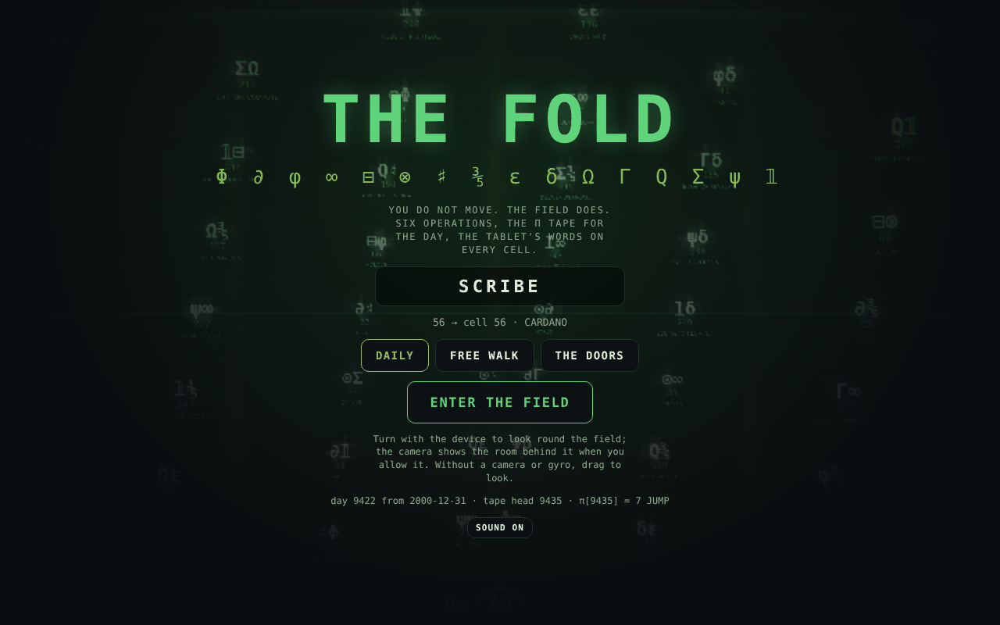
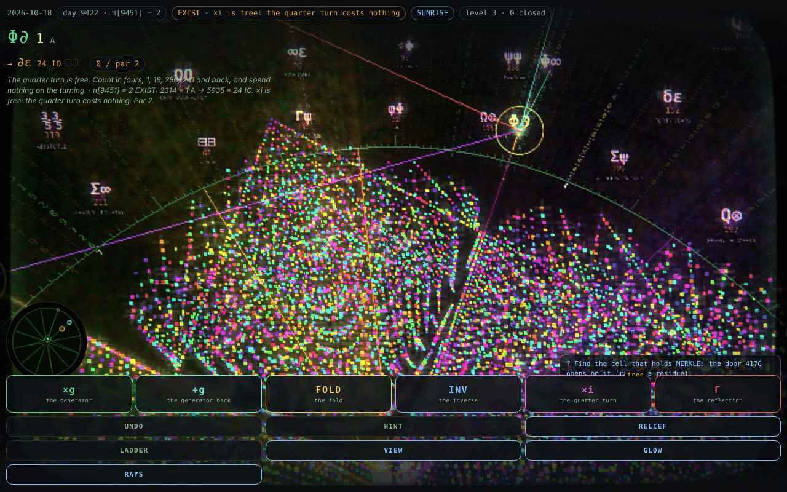
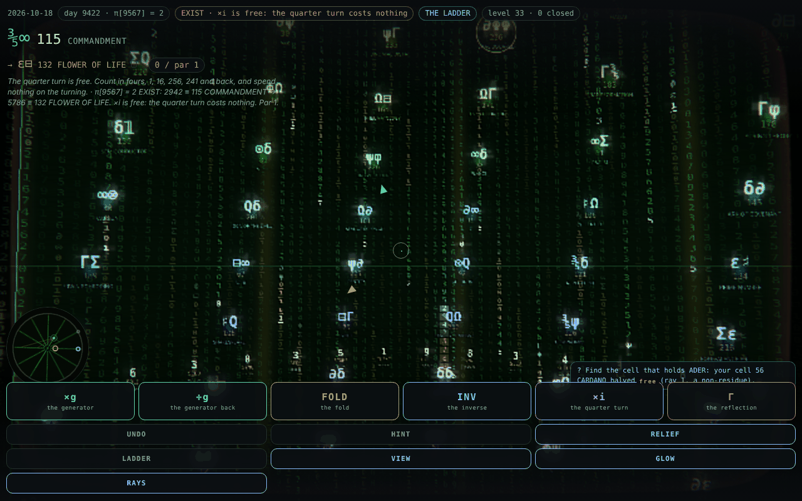
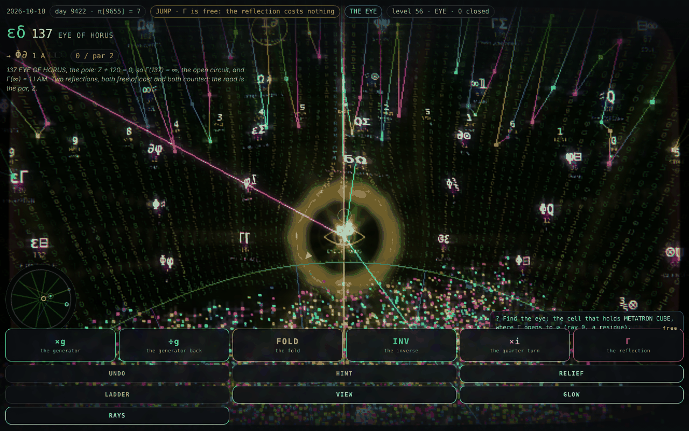
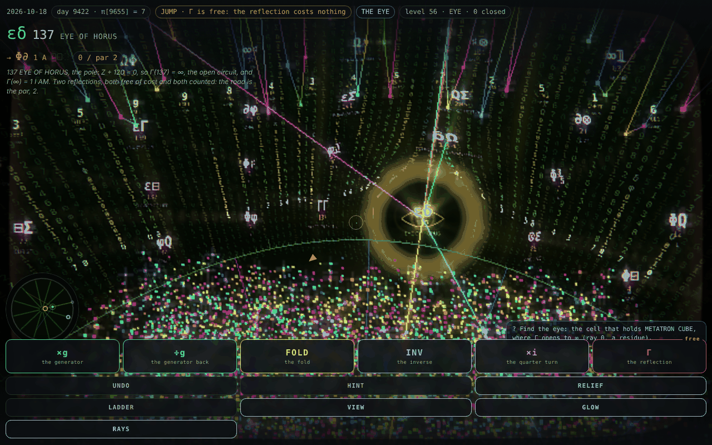
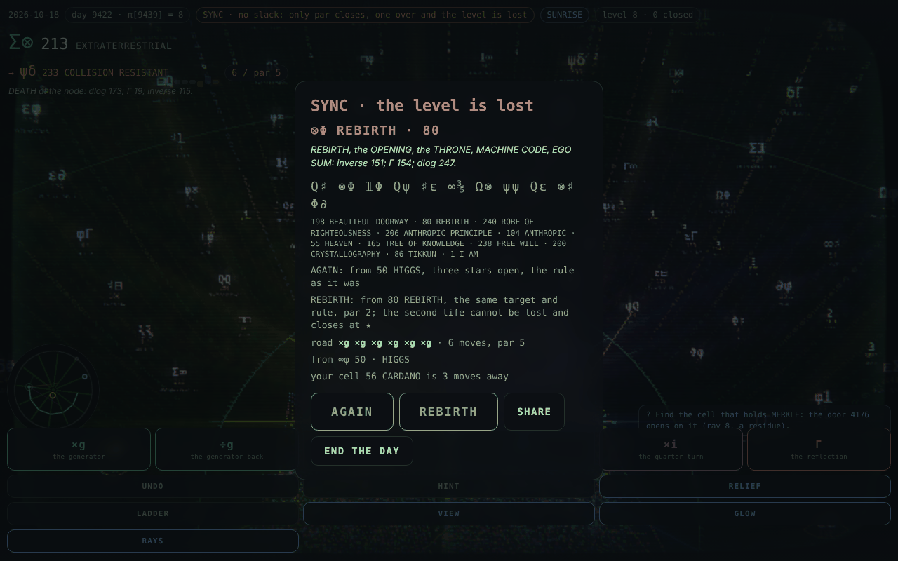
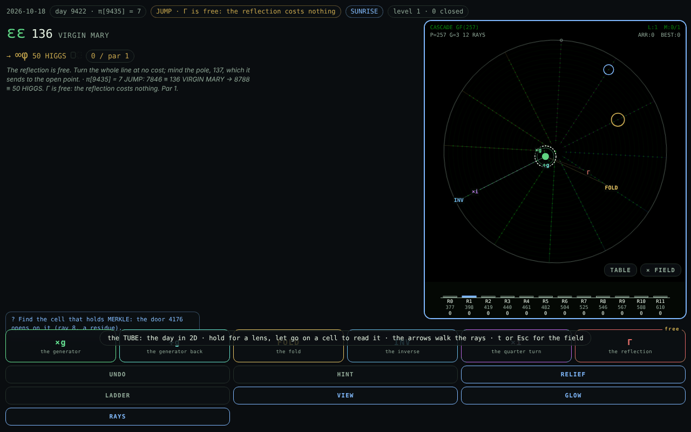
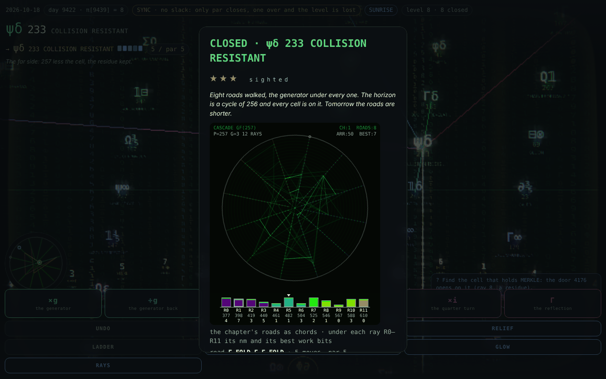

# CASCADE_GAMES

THE FOLD, an augmented-reality game over the field GF(257), with the tools that build its data and the catalogue it draws on.

You do not move; the field does. The 258 points, GF(257) and ∞, stand round you as a sky of cells, each with its glyphs and the
emerald tablet's words, and six moves (×g, ÷g, FOLD, INV, ×i, Γ) permute the whole sky to bring a target to you. Each day reads 64
levels in eight chapters off the π tape, the rule of a level the digit under its head; the sky is that tape as rain, the eye (137,
Γ's pole) is a black hole bending the stars and cells round it, a loss is THE BARDO with a second life from 80 REBIRTH, and the
Twelve Rays draw the field flat as an inset, the TUBE and each chapter's ledger. GLOW: bloom, golden god rays, glitter and a
cyberpunk grade over the same palette. Phones turn it with the gyro over the camera; desktops and Raspbian drag it.

| Path | What it is |
| --- | --- |
| `cascade_ar/` | The game: one page, no build step (see `cascade_ar/README.md`). |
| `build_data.py` | Rebuilds `cascade_ar/data.js` from the emerald tablet and the machine's π tape. |
| `gen_material.py` | Recomputes and checks the arithmetic behind `material.md`, then writes `cascade_ar/parts/corpus/material.js`. |
| `material.md` | The catalogue of motifs, mechanics, words and dates mined from the corpus for the game. |
| `scope.md` | The enhancement scope: the four looks (conic relief, Enter the Void, Matrix, singularity), Twelve Rays and Sisyphean Heat in the game, challenges, HUD, the fixes found on the way, data, phases and budgets. |
| `games_designer_api.py` | Sends a design or review task, with the files you name, to the games-designer agent through the Claude API. |

## Play

Serve the folder over http and open `cascade_ar/index.html` (no build step): `cd cascade_ar && python3 -m http.server 8000`, then
http://localhost:8000/. See `cascade_ar/README.md` for the rules and keys.

## Screenshots



The start screen: a name whose letters add to your cell, DAILY, FREE WALK or THE DOORS, over the sky of cells.



Level 3 (EXIST, chapter SUNRISE) in play, the view tipped down onto the chapter's conics relief as the floor.



Chapter 5's level 33: the π tape as rain at full tier, 256 columns of 78 digits behind the cells, written in the field's glyphs and
binary (each column's glyph pair and its dlog in gold bits), the level's window read out of it in the true digits.



Level 56, THE EYE: 137's shadow in its gold photon ring at full lens tier, the sky, the rain and the cells bent round it.



GLOW on THE EYE: the ring's golden shafts over the field, every cell blooming in its ray's colour, the rain in phosphor green, the
brightest points glittering — one post pass over the half-res scene (bloom, god rays, glitter, a grade), the palette unchanged.



A SYNC level lost one over par: the bardo's card, REBIRTH · 80 with the ten discs, AGAIN and REBIRTH.



The TUBE during play: the field flat on twelve rays, the moves' arrows from your cell, the R0–R11 bars of the day below.



The won card at the end of chapter 1: its eight roads replayed as chords over the R0–R11 bars.

## Rebuilding the game's data

The generators find `cascade_ar/` as a child of their folder (this repository) or as its sibling (the corpus layout, with the
tools in `cascade_machine/cascade_ar_tools/`). The tablet and the machine page live in the corpus, not here:

```
python3 build_data.py path/to/cascade_machine_v4.html path/to/emerald_tablet.json
FOLD_TABLET=path/to/emerald_tablet.json python3 gen_material.py   # reads data.js, so run build_data.py first
```

Without `FOLD_TABLET`, `gen_material.py` reads the tablet from the corpus layout, `<docs>/Φ≡c≡g≡∂ₜΦ≡Oc≡∂ₜΦ≡g≡c≡Φ/emerald_tablet.json`
two levels above the tools. After either run, check the game with `node cascade_ar/parts/corpus/check.js`, and bump `CACHE` in
`cascade_ar/sw.js` so phones that have the game pick up the new files.

`games_designer_api.py` needs `pip install -r requirements.txt` and reads its instructions from
`~/.claude/agents/games-designer-code-agent.md`; run it with `--help` for usage.
