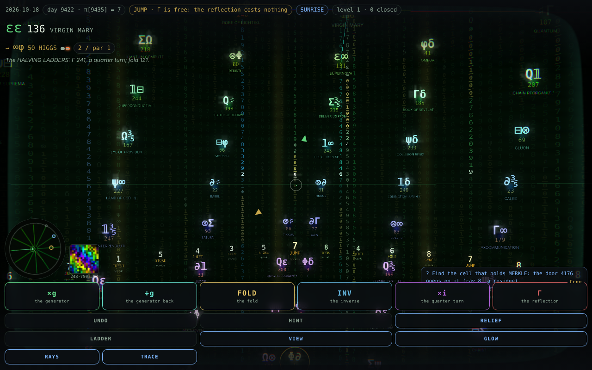
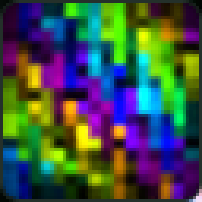
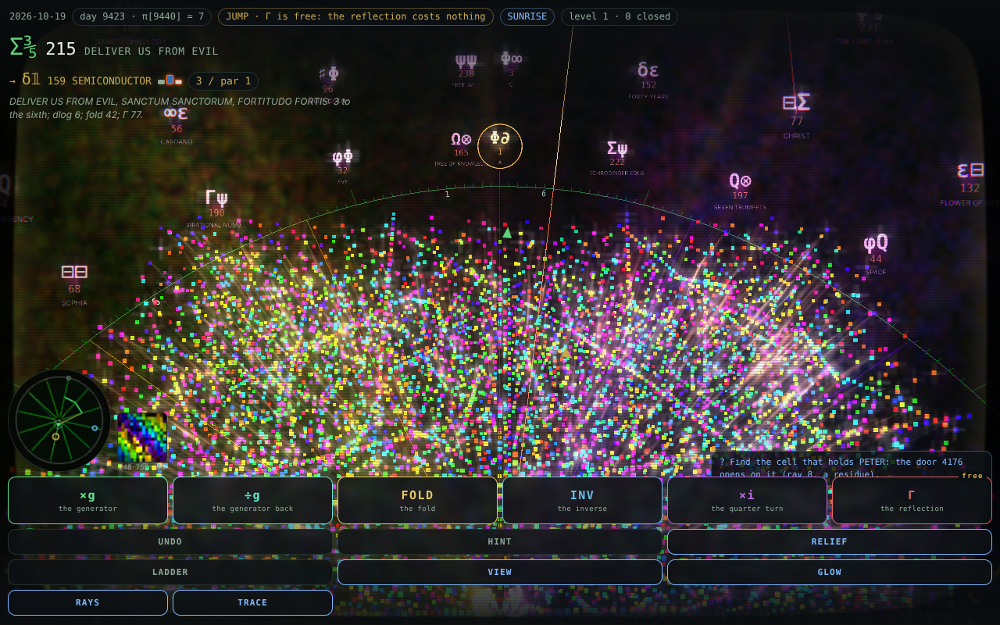
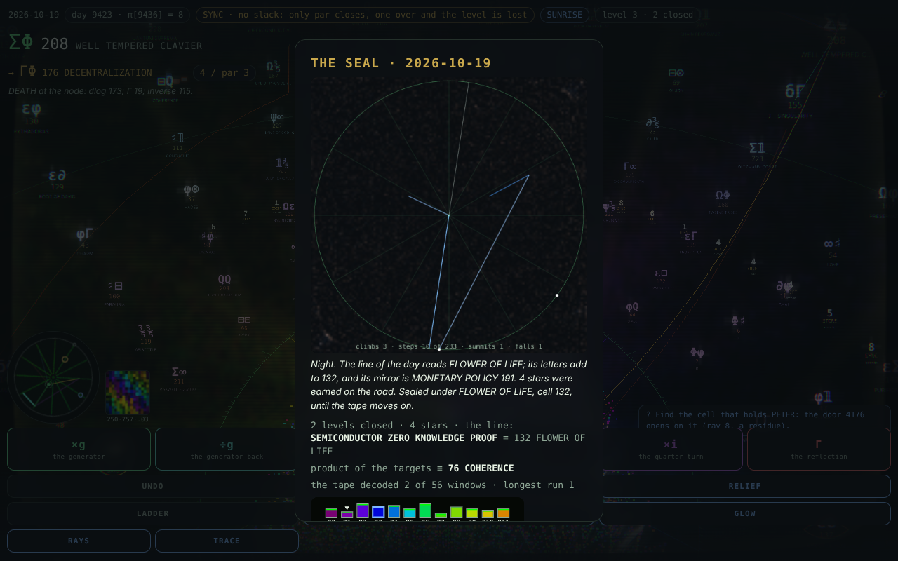
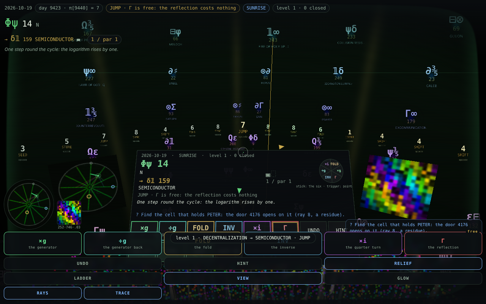

# CASCADE_GAMES

THE FOLD, an augmented-reality game over the field GF(257), with the tools that build its data and the catalogue it draws on.

You do not move; the field does. The 258 points, GF(257) and ∞, stand round you as a sky of cells, each with its glyphs and the
emerald tablet's words, and six moves (×g, ÷g, FOLD, INV, ×i, Γ) permute the whole sky to bring a target to you. Each day reads 64
levels in eight chapters off the π tape, the rule of a level the digit under its head; the sky is that tape as rain, the eye (137,
Γ's pole) is a black hole bending the stars and cells round it, a loss is THE BARDO with a second life from 80 REBIRTH, and the
Twelve Rays draw the field flat as an inset, the TUBE and each chapter's ledger. GLOW: bloom, golden god rays, glitter and a
cyberpunk grade over the same palette. TRACE: the field's own ray tracer in GF(257), 256 rays from your cell bounced by Γ off the
chapter's sheets onto a 16 × 16 tile, its light the third of GLOW's shafts. HEAT: Sisyphean Heat on the chapter's floor, a crowd of
climbers running up the sheet multiplied by your cell over the target and falling where 256 wraps to 0, only their heat drawn; your
own climb as the white climber, a stroke a move; and the day's heat as the picture on the seal. Phones turn it with the gyro over the
camera; desktops and Raspbian drag it; a headset (SteamVR through a browser, or Quest) plays it in VR, the relief at your feet, the
console at your belt and the six moves on the thumbstick. THE LEDGER: the public board of the day's seals, each with its glyph
sequence (the 64 targets closed, in the field's alphabet), and the wall of notes; a day on it is verified by the server replaying
its roads.

| Path | What it is |
| --- | --- |
| `cascade_ar/` | The game: one page, no build step (see `cascade_ar/README.md`). |
| `build_data.py` | Rebuilds `cascade_ar/data.js` from the emerald tablet and the machine's π tape. |
| `gen_material.py` | Recomputes and checks the arithmetic behind `material.md`, then writes `cascade_ar/parts/corpus/material.js`. |
| `material.md` | The catalogue of motifs, mechanics, words and dates mined from the corpus for the game. |
| `scope.md` | The enhancement scope: the four looks (conic relief, Enter the Void, Matrix, singularity), Twelve Rays and Sisyphean Heat in the game, challenges, HUD, the fixes found on the way, data, phases and budgets. |
| `games_designer_api.py` | Sends a design or review task, with the files you name, to the games-designer agent through the Claude API. |
| `fold_cli.js` | The game without the page, through its own engine: the day's plan as text, a road scored, a day played and sealed, two days compared level by level. For agents, and for beating your own machine (see Agents below). |
| `deploy/` | The site at https://start.cascade.training: Caddyfile (or nginx), one-time install, the deploy script, the GitHub Action that deploys on push to main, and THE LEDGER's service (see `deploy/README.md`). |
| `CHANGELOG.md` | Every release, newest first, by the service worker's `CACHE` version. |

## Play

Live at https://start.cascade.training/. Locally, serve the folder over http and open `cascade_ar/index.html` (no build step):
`cd cascade_ar && python3 -m http.server 8000`, then http://localhost:8000/; or `node deploy/ledger/server.js`, which serves the game
with a ledger of its own at http://localhost:8257/. See `cascade_ar/README.md` for the rules and keys.

## Agents

Machines are welcome to play. https://start.cascade.training/llms.txt is the rulebook in text (`cascade_ar/llms.txt`, pointed to by
`robots.txt`), and `fold_cli.js` plays the game without a browser, through the same engine the page runs:

```
node fold_cli.js plan SCRIBE                   the day's 64 levels: start, target, rule, par, what is free
node fold_cli.js level SCRIBE 1                one level in full, with where each move lands
node fold_cli.js play SCRIBE 1 "r r r G r r"   one road through the engine: the steps, the outcome, the share line
node fold_cli.js day SCRIBE roads.txt          a roads file (one level a line, `L: road`) as the day, with the seal
node fold_cli.js vs SCRIBE you.json bot.txt    a person's day (the page's saved run) against a machine's, level by level
node fold_cli.js post SCRIBE roads.txt --league thinking   the day onto THE LEDGER, verified by the site; --msg "…" alone for a note
node fold_cli.js ledger                        the day's board: every seal with its glyph sequence, and the wall
```

The plan is deterministic by day and name, so a person and a machine playing the same name face the same levels. A road is the
moves as letters, g G f i q r x (×g ÷g FOLD INV ×i Γ 6↔9). Two leagues: THINKING, from the rules and your own reasoning with no
solver, is the one a person can win; SCRIPTED is anything goes, and the solver closes every level at par. Any day by `--day N` or
`--date YYYY-MM-DD`; `--json` for a machine; `node fold_cli.js --help` for the rest.

## Screenshots


The start screen: a name whose letters add to your cell, DAILY, FREE WALK or THE DOORS, over the sky of cells.


Level 3 (EXIST, chapter SUNRISE) in play, the view tipped down onto the chapter's conics relief as the floor.


Chapter 5's level 33: the π tape as rain at full tier, 256 columns of 78 digits behind the cells, written in the field's glyphs and
binary (each column's glyph pair and its dlog in gold bits), the level's window read out of it in the true digits.


Level 56, THE EYE: 137's shadow in its gold photon ring at full lens tier, the sky, the rain and the cells bent round it.


GLOW on THE EYE: the ring's golden shafts over the field, every cell blooming in its ray's colour, the rain in phosphor green, the
brightest points glittering — one post pass over the scene at the screen's own resolution (bloom, god rays, glitter, a grade, the
light at a quarter), the palette unchanged.



TRACE in play (level 1, the tile at the bottom left beside the rays inset, and at 4× below): the field's own ray tracer — 256
directions from THE TURN, hits by the character, bounces by Γ and Snell, onto the 16 × 16 display through the Airy beam; its light
feeds GLOW's shafts, here the third light's from the top of the frame, where the field says the light arrives at the cell.





HEAT, the view tipped onto the floor: 3584 climbers on the chapter's sheet multiplied by your cell over the target, blue climbs
whitening with heat, orange-white flares where they go over the wrap, the floor itself re-formed by every move; the white climber at
your cell's azimuth, its strokes the moves.



THE SEAL with the day's heat: the crowd's ground from each close, the day's climbs from the centre toward the rim in the moves'
colours, an orange streak to the centre for a loss, the crown of closed cells on the rim, and the sketch's counters as the day's.



The headset's console as the flat preview draws it: the HUD, the effort bar's segments, the stick's six sectors, the voice and the
quest, and the six moves with UNDO, HINT, RELIEF, VIEW, HEAT and EXIT VR as buttons; the rays and trace insets beside it. In VR it
hangs at the belt and follows a glance down; the controllers' rays press it.


A SYNC level lost one over par: the bardo's card, REBIRTH · 80 with the ten discs, AGAIN and REBIRTH.


The TUBE during play: the field flat on twelve rays, the moves' arrows from your cell, the R0–R11 bars of the day below.


The won card at the end of chapter 1: its eight roads replayed as chords over the R0–R11 bars.

## Making a change

Every change under `cascade_ar/` is a release: bump `CACHE` in `cascade_ar/sw.js` (a phone that has the game fetches the new
files only then), add the version's entry at the top of `CHANGELOG.md`, and keep the two READMEs true (this one's description and
screenshots, `cascade_ar/README.md`'s Play, keys and Files). A new part gets `check.js`, `notes.md` and `demo.html` beside it, a
script tag in `index.html` and a line in `sw.js`'s SHELL. Then run every suite:

```
for f in cascade_ar/parts/*/check.js cascade_ar/parts/levels/test.js; do node "$f" | tail -n 1; done
node fold_cli.js check
```

The corpus check holds `index.html`'s scripts to SHELL and the changelog's newest entry to `CACHE`, so a forgotten bump or entry
fails it, and the deploy workflow runs the same suites before anything reaches the server.

## Rebuilding the game's data

The generators find `cascade_ar/` as a child of their folder (this repository) or as its sibling (the corpus layout, with the
tools in `cascade_machine/cascade_ar_tools/`). The tablet and the machine page live in the corpus, not here:

```
python3 build_data.py path/to/cascade_machine_v4.html path/to/emerald_tablet.json
FOLD_TABLET=path/to/emerald_tablet.json python3 gen_material.py   # reads data.js, so run build_data.py first
```

Without `FOLD_TABLET`, `gen_material.py` reads the tablet from the corpus layout, `<docs>/Φ≡c≡g≡∂ₜΦ≡Oc≡∂ₜΦ≡g≡c≡Φ/emerald_tablet.json`
two levels above the tools. After either run, check the game with `node cascade_ar/parts/corpus/check.js`, and bump `CACHE` in
`cascade_ar/sw.js` so phones that have the game pick up the new files.

`games_designer_api.py` needs `pip install -r requirements.txt` and reads its instructions from
`~/.claude/agents/games-designer-code-agent.md`; run it with `--help` for usage.
